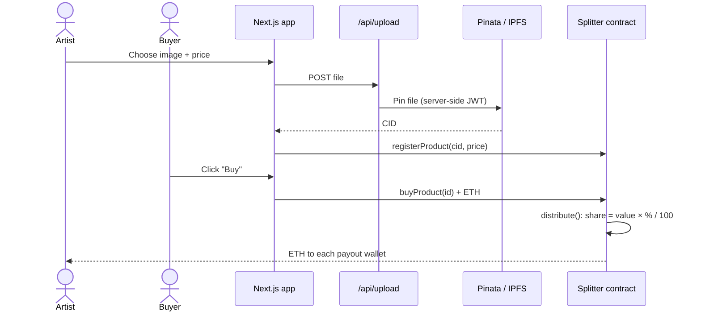

# SplitStream

**An on-chain art marketplace where every sale is split between collaborating artists automatically.**

Artists upload a piece of digital art, which is pinned to IPFS and registered on Ethereum with a price. When a collector buys it, the `Splitter` smart contract divides the payment between the artists' wallets in the same transaction. Every split is visible on-chain.

> Runs on the **Sepolia testnet**. It's a learning and portfolio project, not audited for mainnet use. See [Known limitations](docs/contract.md#known-limitations).

## Features

- **Upload & register:** pin an image to IPFS through Pinata, then record its CID and price on-chain.
- **Marketplace:** browse registered works and buy with MetaMask; a link to the Etherscan receipt follows each purchase.
- **Automatic revenue split:** each purchase is split by fixed percentages (e.g. 40 / 30 / 30) in a single transaction.
- **Collector view:** see the works you've bought, rebuilt from on-chain `ProductPurchased` events.
- **Artist dashboard:** payout wallets see total revenue received, sales count and their uploaded works, updating live as sales happen.

## How it works



The contract holds a fixed list of payout wallets and percentages that must add up to 100, set once at deploy time. The image itself lives on IPFS. On-chain, the contract stores only its content hash (CID), the creator and the price.

## Tech stack

| Layer | Tools |
|---|---|
| Smart contract | Solidity 0.8.20, Hardhat, Chai/Mocha tests |
| Frontend | Next.js 16, React 18, ethers v6, Tailwind CSS |
| Storage | IPFS via Pinata |
| Network | Ethereum Sepolia testnet, MetaMask |

## Repository layout

```
contracts/Splitter.sol        The marketplace + revenue-split contract
test/Splitter.test.js         Contract tests
scripts/deploy.js             Deploys Splitter (localhost or Sepolia)
hardhat.config.js             Networks and compiler settings
frontend/
  pages/                      index, marketplace, upload, dashboard
  app/api/upload/route.js     Server-side proxy to Pinata (keeps the JWT secret)
  context/Web3Context.js      Wallet connection + all contract calls
  components/, utils/         UI pieces and formatting helpers
  abi/Splitter.json           Compiled contract ABI used by the frontend
docs/                         Contract reference and deployment guide
```

## Getting started

### Prerequisites

- Node.js 20.9+ and npm (required by Next.js 16)
- [MetaMask](https://metamask.io/) with some Sepolia test ETH (from a Sepolia faucet)
- A free [Pinata](https://app.pinata.cloud/) account, to get a JWT for uploads
- An RPC URL for Sepolia from a provider such as Alchemy or Infura. You only need this to deploy your own contract.

### 1. Install

```bash
git clone https://github.com/mapalomaseko/splitstream.git
cd splitstream
npm install
cd frontend && npm install && cd ..
```

### 2. Run the contract tests

These need no configuration:

```bash
npm test
```

### 3. Deploy the contract

Copy `.env.example` to `.env` and fill it in. Then:

```bash
npm run deploy:sepolia
```

The script prints the values for the frontend's `.env`. See [docs/deployment.md](docs/deployment.md) for the full walkthrough.

### 4. Run the frontend

```bash
cp frontend/.env.example frontend/.env   # then fill in the values printed by the deploy step + your Pinata JWT
cd frontend
npm run dev
```

Open http://localhost:3000 and connect MetaMask. The app will prompt you to switch to Sepolia.

> **Local Hardhat network:** `npm run node` followed by `npm run deploy:local` deploys to a local chain. Use it for contract development. The frontend always switches MetaMask to Sepolia, so the end-to-end UI flow needs a Sepolia deployment.

## Configuration

There are two `.env` files: one for Hardhat at the repo root, and one for Next.js in `frontend/`. Neither is committed.

| Variable | File | Purpose |
|---|---|---|
| `PRIVATE_KEY` | `.env` | Deployer key for a **test-only** wallet (Sepolia deploys only) |
| `SEPOLIA_RPC_URL` | `.env` | Sepolia RPC endpoint |
| `ARTIST_ADDRESSES` | `.env` | Comma-separated payout wallets for the contract |
| `ARTIST_PERCENTAGES` | `.env` | Matching percentages, must total 100 (e.g. `40,30,30`) |
| `NEXT_PUBLIC_CONTRACT_ADDRESS` | `frontend/.env` | Deployed `Splitter` address |
| `NEXT_PUBLIC_DEPLOY_BLOCK` | `frontend/.env` | Block the contract was deployed in. Event queries start here. |
| `NEXT_PUBLIC_ARTIST_ADDRESSES` | `frontend/.env` | Wallets that can open the artist dashboard |
| `NEXT_PUBLIC_HIDDEN_PRODUCT_IDS` | `frontend/.env` | Product IDs to hide from the marketplace |
| `PINATA_JWT` | `frontend/.env` | Pinata API JWT. Server-only, never sent to the browser. |

`NEXT_PUBLIC_*` values are embedded in the browser bundle, so never put a secret in one.

## Documentation

- [Contract reference & known limitations](docs/contract.md)
- [Deploying to Sepolia](docs/deployment.md)

## License

[MIT](LICENSE)
